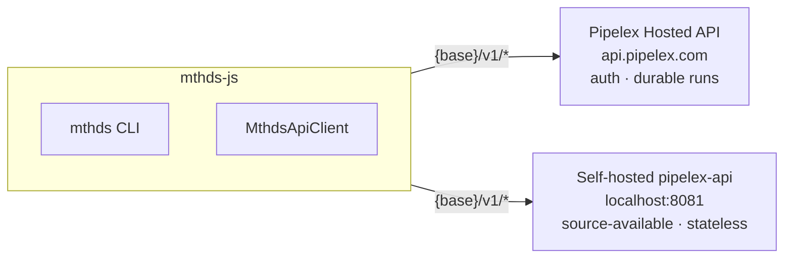

# Using a runner API — hosted or self-hosted

`mthds-js` runs methods either with the **`pipelex` runner** (a Python CLI on your machine, the default) or with an **HTTP runner** — an MTHDS-compliant API server. This page is about the HTTP runner: how to point the CLI and SDK at one.

The `pipelex` runner can reach the hosted API too, by another route: pipelex executes a run on this machine or on the hosted Pipelex API, as its own `[run] execution` setting or a `--hosted`/`--local` flag says, with its own key (`PIPELEX_API_KEY` in `~/.pipelex/.env`, which `mthds login` saves). That route is pipelex's, and `CLI.md` describes it under "Where the pipelex runner executes a run"; this page is about the HTTP runner.

There are two common targets, and the same `MthdsApiClient` and `mthds` CLI drive both:

- **Pipelex Hosted API** — the managed runner at `https://api.pipelex.com` (the default). Authenticated, with durable runs.
- **Self-hosted** — a bare [`pipelex-api`](https://docs.pipelex.com/latest/api-server/) runner you boot yourself (source-available under the Elastic License 2.0, stateless).

The MTHDS Protocol surface is identical on both. The only things that change are the **base URL** and whether you need a key.



## One base URL

There is a single configuration pair. The base URL is the **host only — no version prefix**; the SDK composes every endpoint as `{base}/v1/{endpoint}`.

| Config key | Env var | Default |
|---|---|---|
| `base-url` | `MTHDS_BASE_URL` | `https://api.pipelex.com` |
| `api-key` | `MTHDS_API_KEY` | (empty) |

So `execute` hits `<base>/v1/execute`, `validate` hits `<base>/v1/validate`, and so on. `/health` is the exception — it is origin-level, resolving to `<scheme>://<host>/health`, not under `/v1`.

Environment variables take precedence over the config file. The `MthdsApiClient` constructor reads `MTHDS_BASE_URL` / `MTHDS_API_KEY` as fallbacks, and an explicit `baseUrl` / `apiKey` overrides them — the constructor doesn't read the config file itself; the CLI loads the file and passes the resolved values in. Configuration is stored in `~/.mthds/config` and shared with `mthds-python`.

> The base URL must be host-only — `http`/`https`, no path, query, fragment, or credentials. A path-prefixed value such as `…/v1` would compose into a malformed `/v1/v1/…` endpoint, so the client rejects it up front.

## Hosted vs. self-hosted at a glance

| | Pipelex Hosted API | Self-hosted bare runner |
|---|---|---|
| Base URL | `https://api.pipelex.com` (default) | your host, e.g. `http://localhost:8081` |
| API key | required | optional (anonymous is fine) |
| Protocol surface (`execute` / `start` / `validate` / `models` / `version`) | ✅ | ✅ |
| Synchronous request cap | ~30s (gateway) | none from the runner — bounded by your reverse proxy |
| Durable poll-by-id (`/v1/runs/*`) | ✅ via [`@pipelex/sdk`](./run-lifecycle.md) | ❌ stateless — those routes `404` |
| Client-supplied `pipeline_run_id` | rejected (`422`) | accepted (passed via `extra`) |

## Setup

### Hosted (default)

```bash
mthds config set runner api          # switch from the local pipelex runner to the HTTP runner
mthds config set base-url https://api.pipelex.com
mthds config set api-key YOUR_KEY
```

Or run `mthds runner setup api` for an interactive prompt (base URL + masked key).

This `api-key` is the HTTP runner's own. It is not the `PIPELEX_API_KEY` that `mthds login` and `pipelex login` save to `~/.pipelex/.env` for the `pipelex` runner's hosted runs: each route reads only its own key, and setting one does not set the other.

### Self-hosted

Boot a bare runner, then point at it — no key needed:

```bash
mthds config set runner api
mthds config set base-url http://localhost:8081
```

See the [`pipelex-api` documentation](https://docs.pipelex.com/latest/api-server/) for how to run the server, and its [configuration page](https://docs.pipelex.com/latest/api-server/configuration/) for its settings.

## How runs behave against each

**Synchronous runs.** `mthds run pipe` and `mthds run bundle` call the blocking `POST /v1/execute` (see [run-lifecycle.md](./run-lifecycle.md)).

- *Hosted:* the gateway caps synchronous requests at ~30s; a longer run raises `PipelineExecuteTimeoutError`.
- *Self-hosted:* the runner holds the connection as long as it needs, but your own reverse proxy (nginx, ALB, Cloud Run, …) typically imposes an idle timeout (~60s). Raise it for long runs.

For anything long-running, prefer `start` over `execute`. The async `start` primitive is part of the **SDK** (`client.start`), not a CLI subcommand — `mthds run …` is always synchronous.

**Durable poll-by-id.** Submitting a run and later polling it by `pipeline_run_id` is a hosted-API feature provided by [`@pipelex/sdk`](./run-lifecycle.md), not by `mthds-js`. A bare runner is stateless and has no run store, so its `/v1/runs/*` routes `404`. For fire-and-forget completion against a bare runner, `pipelex-api` offers HMAC-signed webhooks via its `callback_urls` extension arg (passed through `extra`).

**Output shape.** The blocking `execute` path returns the runner's native `pipe_output`. The hosted durable path (in `@pipelex/sdk`) instead returns `main_stuff` + `graph_spec`. For v1 this difference is documented, not normalized (TODO).

## Sending a method's tree

A method is more than its `.mthds` text: its custom Python (`funcs/*.py`, `structures/*.py`), its templates, its images and its manifest travel with it. The MTHDS standard calls that set of files the method's tree and defines which files belong to it (see [method-tree.md](./method-tree.md)); a runner receives the tree as the `files` map of `POST /v1/execute`, `POST /v1/start` and `POST /v1/validate`, each key a tree path and each value a file entry (a text, a `{ base64 }` object or a `{ sha256, size }` hash).

**What a command line sends.** `mthds run bundle`, `mthds run pipe`, `mthds validate pipe`, `mthds-agent validate bundle`, `mthds-agent validate pipe` and `mthds-agent run start` resolve their target into one tree with `resolveMethodTarget` in `src/runners/method-target.ts`:

- A directory is listed from its root, which Manifest Discovery finds.
- A `.mthds` file under a `METHODS.toml` is sent in that manifest's tree, the file being the bundle the command named.
- A `.mthds` file with no manifest above it is a one-file tree, so nothing beside it travels. Name its directory, or add a `METHODS.toml`, to send the files beside it.
- Inline `--content` is a one-file tree of its own, under the tree path `bundle.mthds`.

A request carries one tree, so on the API runner a library directory (`-L`) cannot add a second one. A library directory inside the tree's root adds nothing, the tree already holding its files. A library directory holding a `.mthds` file named alone becomes that file's root, so `mthds run bundle child.mthds -L ./method/` sends the whole directory with `child.mthds` as the bundle to run, as the pipelex runner loads the directory beside the file. Any other library directory, and any library directory beside `--content`, is refused with a message saying how to make one tree of the files. The pipe that runs is `--pipe` when given, else the named bundle's `main_pipe`.

**How the client sends it.** `MthdsApiClient` takes the method either as `tree`, a `MethodTreeSource` such as the `MethodTree` the lister returns, or as a ready `files` map, never both (`assertOneMethodSource` in `mthds/protocol`). A `files` map is posted as given. A tree is sent by the rule of the standard's "Sending files by hash" section:

- The client asks the runner's `GET /v1/version` handshake once in its lifetime. The handshake says whether the runner keeps a blob store (`blob_store`), and the hosted runner announces its tree limits under `limits.method_tree`, which the CLI hands to the lister so that a folder handed over by mistake is refused while it is listed, before anything is read or hashed (`methodTreeLimits()`).
- The whole tree travels inline when the runner keeps no blob store, or when its inline map weighs `INLINE_TREE_MAX_BYTES` (256 KiB) or less and no more than the runner's announced `max_inline_bytes`. The weight is what the request spends: the map serialized as JSON with no whitespace, in UTF-8, so a binary file counts as its Base64 text, about a third more than its bytes.
- Otherwise every file travels by hash. The client posts the tree's digest and its distinct blobs to `POST /v1/blobs/missing`, uploads each blob the answer names to the target the runner gave for it, at most four at a time, and then sends the map of hash entries. A tree is never split between the two forms, so a run of an unchanged large method uploads nothing.
- An upload sends exactly the method and headers the runner gave. It never carries the client's `Authorization` header, and it carries the client's `User-Agent` only when the target shares the runner's origin. A `412` answer means the store already holds the bytes, which counts as uploaded. A failed upload raises `BlobUploadError`, which names the blob, the status and the target's host, never its URL, since an upload URL can carry a signature.
- When the runner refuses a by-hash request with a `422` naming `missing_blobs`, because a blob expired between the check and the run, the client asks `/v1/blobs/missing` for those blobs, uploads them, and sends the request once more.

`prepareMethodFiles(tree)`, `findMissingBlobs(request)` and `uploadBlob(blob, bytes)` expose the same steps to a caller that drives them itself.

**On the pipelex runner.** The pipelex runner keeps no blob store: it reads the tree, writes it to a temporary directory and hands the named bundle to `pipelex run bundle` or `pipelex validate bundle` with that directory as a library (`-L`), so the method's Python resolves when pipelex runs it on this machine. A hash entry in a caller's `files` map is refused there. Its own `-L` directories are passed to pipelex as they are. When pipelex executes the run on the hosted Pipelex API instead (`[run] execution = "hosted"`), what travels is pipelex's own choice.

**Custom Python.** A `.py` file is only executed on a sandbox-hosted deployment; a runner with no sandbox refuses a method that needs one with `CustomCodeRequiresSandbox`.

**The inputs commands.** `POST /v1/pipe-io` takes `.mthds` files rather than a method's tree, so `mthds-agent inputs bundle|pipe` and `mthds build inputs` still send a closure of `.mthds` files: `resolveBundleClosure` in `src/runners/bundle.ts` collects every `.mthds` file of a directory target and of each `-L` directory, skipping the folders pipelex's library scan skips (its virtual environments, caches and run outputs, and any folder the user may not list), puts the named file first, or a directory's entry file, chosen as the pipelex runner chooses it (`bundle.mthds`, else the only root file), pins the entry's own `main_pipe` for the inputs template, sends a file reached twice only once, and names each one by its path for the diagnostics. `CLI.md` has the details, including the graph options that only the pipelex runner can honour.

## Minimum server version

The SDK composes every endpoint under `/v1`, so a self-hosted runner must mount its API at `/v1` (the MTHDS Protocol cutover). Older images mounted `/api/v1` and answer `404` on every call — including the `/v1/version` handshake. Upgrade your runner image before (or together with) this SDK version.

## SDK

```typescript
import { MthdsApiClient } from "mthds";

// Hosted
const hosted = new MthdsApiClient({
  baseUrl: "https://api.pipelex.com",
  apiKey: "your-api-key",
});

// Self-hosted (bare runner)
const selfHosted = new MthdsApiClient({
  baseUrl: "http://localhost:8081",
  // apiKey optional for an anonymous bare runner
});
```

With no options, the constructor reads `MTHDS_BASE_URL` and `MTHDS_API_KEY` from the environment, falling back to the hosted default.

## See also

- [run-lifecycle.md](./run-lifecycle.md) — `execute` vs. `start`, and durable poll-by-id.
- [pipe-io.md](./pipe-io.md) — `pipeIo()`: a method's pipe I/O contracts, input form and output form in one call, with no dry run.
- [architecture.md](./architecture.md) — the SDK's protocol/runner split and the `MthdsApiClient` surface.
- [errors.md](./errors.md) — the exception taxonomy: `PipelineExecuteTimeoutError`, `ApiResponseError`, `ApiUnreachableError`, and the rest.
- [`pipelex-api`](https://docs.pipelex.com/latest/api-server/) — the runner's documentation and its own [OpenAPI contract](https://docs.pipelex.com/latest/api-server/openapi/pipelex-api.openapi.yaml); its source is the [`api/` member of the pipelex repository](https://github.com/Pipelex/pipelex/tree/main/api). The MTHDS Protocol spec (`mthds-protocol.openapi.yaml`) lives in the standard repo.
