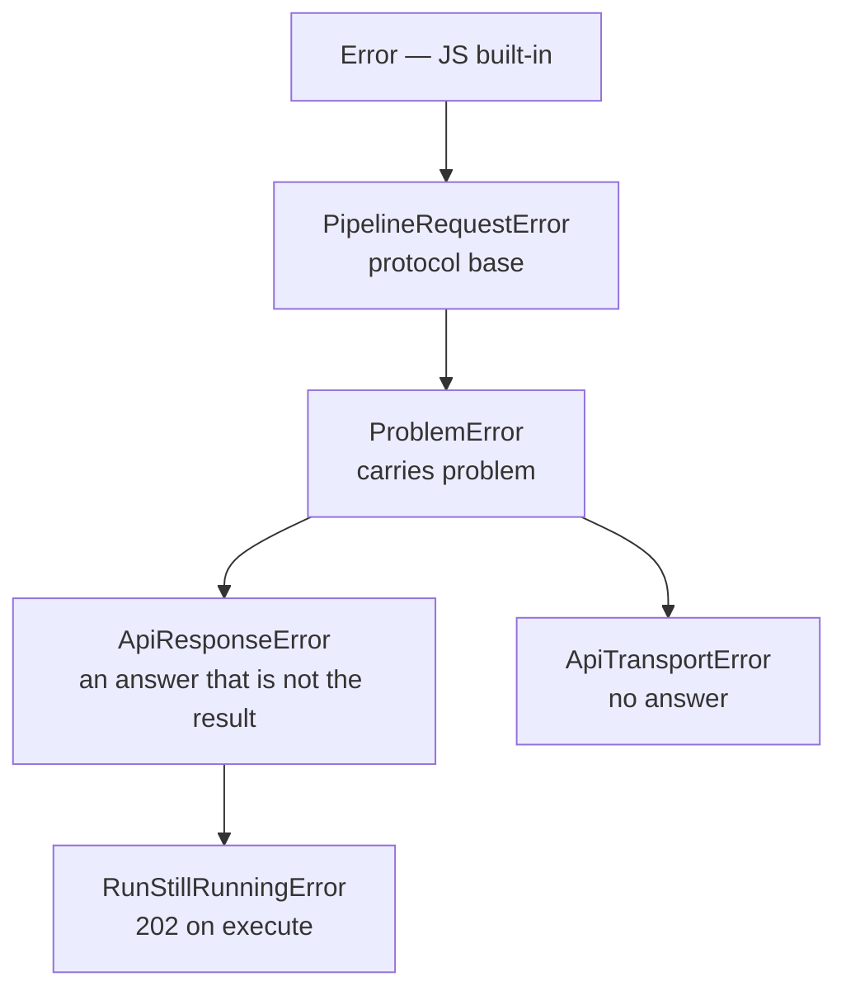

# Errors — problems coded from the core registry

Every failure this package reports is one **problem document**: the MTHDS Protocol's error document (mthds `docs/spec/protocol.md`, "Errors"), whose `code` is a code of the MTHDS core error registry or of a registered extension prefix. A runtime's answer is read as the problem it carries, a failure the client detects itself is built as the problem of a client code, and `mthds-agent` writes the same document on its error stream. A caller branches on `code`, and on `domain`, `retry` and `next_step.kind` when it handles several codes alike, never on a message, an HTTP status or an exit code.

The registry is vendored from the standard and generated into a typed module (see [The vendored registry](#the-vendored-registry)), so every code, its parameters and its templates are known at compile time.

## Entry points

The problem module (`src/problems/`) imports nothing but itself and the protocol's base error, and no Node built-in, which `.dependency-cruiser.cjs` enforces, so every entry point can export it:

| Export | `mthds` | `mthds/errors` | `mthds/protocol` |
|---|---|---|---|
| `PipelineRequestError`, `ProblemError` and the problem module (types, registry, readers, builders, renderers) | yes | yes | yes |
| `ApiResponseError`, `RunStillRunningError`, `ApiTransportError` | yes | yes | no (runner layer) |

`mthds/errors` carries the whole taxonomy and nothing that reaches `node:fs`, so a module bundled for a browser imports from it. For why the entry point exists, see [architecture.md → "Why `mthds/errors` exists"](./architecture.md#why-mthdserrors-exists).

> An **invalid method is not an error.** `POST /v1/validate` and `POST /v1/pipe-io` answer an invalid method with a produced verdict, a `200` whose `is_valid` is `false` and whose `errors` list its faults as items. Exceptions are reserved for *no-verdict* conditions. See [architecture.md → "`/validate` is a 200-diagnostic surface"](./architecture.md#validate-is-a-200-diagnostic-surface).

## The problem document

| Member | Meaning |
|---|---|
| `type`, `title` | The code's URI (`https://mthds.ai/errors/<code>` for a core code, the prefix's base URL for an extension code) and its short label. |
| `status` | The HTTP status of the answer the problem came on. A problem the client builds for a client code has none, and neither does the JSON a CLI writes. |
| `detail` | This occurrence in one sentence, the registry's template filled with `params`. |
| `code` | The code a program branches on, such as `input.missing` or `client.unreachable`. |
| `domain` | Who must act: `input` (the caller), `method` (the method's author), `account` (the account's owner), `operator` (whoever runs the runtime) or `runtime` (nobody beforehand). |
| `retry` | Whether repeating can succeed: `no`, `yes` (after `retry_after` seconds when given) or `outcome_unknown`, the operation may already have taken effect, so a client never repeats it by itself. |
| `next_step` | `{ kind, detail }`: what to do, as one kind of a closed list (`retry`, `wait`, `read_run`, `change_input`, `change_method`, `fix_configuration`, `upgrade`, `report` and the others of the protocol's table) and a sentence. |
| `params` | The code's parameters, present whenever the code declares any; an operator-only parameter is never sent, so `params` can be `{}`. |
| `location`, `errors`, `pipeline_run_id` | Where the fault happened, the items of a problem with several faults, and the run when one exists. |
| any other member | The implementation's own, kept at the top level as received, such as a runtime's `request_id` or a CLI's `message`. |

The types are `Problem`, `ProblemItem`, `ProblemLocation`, `NextStep`, `SuggestedFix` and the `FixOp` variants, exported from every entry point. `ProblemParamsByCode` types each core code's parameters, and `ERROR_CODES` holds every core code as a constant (`ERROR_CODES.CLIENT_UNREACHABLE` is `"client.unreachable"`).

### Reading a value this reader does not know

A reader widens `domain`, `retry`, `next_step.kind` and a fix's `safety` to any string, so a newer runtime's value never makes a problem unreadable. The readers in `src/problems/reading.ts` turn each into a value of the closed list:

| Reader | A value it does not know reads as |
|---|---|
| `problemDomain(problem)` | the domain every known code of the code's family shares, else `runtime` |
| `problemRetry(problem)` | `no`: an unknown verdict never invites a repeat |
| `problemStepKind(problem)` | the step kind every known code of the family shares, else `report` |
| `itemDomain(item)` | an item has no domain: its code's, else the family's, else `runtime` |
| `fixSafety(fix)` | `unsafe` |
| `isApplicableFix(fix)` | `false` when any operation is of a kind the protocol does not list (`UnknownFixOp`) |

A code the registry does not declare is read as received: its own `detail` and `next_step` are the ones to show.

## The classes



Every error the client and the runners raise is a `ProblemError`, so `catch (err) { if (err instanceof ProblemError) … }` reaches the problem of any of them.

### `ProblemError`

Carries `problem`, as received or as the client built it. Its `message` is the problem's `message` member when it has one, the caller's own sentence for a refusal it built, else its `detail`, followed by the next step's sentence (`problemErrorMessage`), so that a message read alone still says what to do. Its getters read the problem: `code`, `domain`, `retry` and `nextStep` (read into the closed lists as above), `retryAfter` and `requestId`. `problemError(code, params, { message, cause, reader })` builds one for a core code, and `argumentInvalid(argument, reason, message)` the refusal of an argument before any request left.

### `ApiResponseError`

The runtime answered, and the answer is not the route's result. Beside `problem` it keeps the answer's facts: `apiUrl`, `route` (`POST /v1/execute`), `status` (the answer's, whatever the problem says), `statusText` and `responseBody`. Its `requestId` falls back to the answer's `X-Request-ID` header when the problem names no `request_id`, and `reportedProblem(err)` gives the problem with that request id added, which is what both CLIs print. Its message opens with the route and the status, and, when the body is no problem document, ends with the start of the body, its whitespace collapsed and cut at `BODY_EXCERPT_LENGTH` characters. The runtime's raw text appears there only: no member of a problem the client builds ever holds it.

### `RunStillRunningError`

A blocking `execute` the runtime accepted asynchronously, a `202` with the run's id, read as `client.follow_failed`: the run keeps going and this client does not follow it. It adds `runId`, `retryAfterSeconds` (the `Retry-After` header) and `location` (the `Location` header). Read the run by its id with the durable run API of [`@pipelex/sdk`](./run-lifecycle.md) rather than start it again.

### `ApiTransportError`

No answer came back. It adds `apiUrl` and `networkCode`, the transport's own code such as `ECONNREFUSED` when it gives one; `cause` is what fetch threw.

## How the client reads an answer

`MthdsApiClient` reads every answer of every route (`execute`, `start`, `validate`, `models`, `version`, `pipeIo`, `health`) by the same rules, which the shared reading cases pin (`tests/fixtures/problem-reading-cases.json`, a byte-for-byte copy of the Python client's file, run by `tests/unit/problems/reading-cases.test.ts`):

| The answer | Reads as |
|---|---|
| A body that is a problem document: JSON, nested no deeper than `MAX_BODY_NESTING`, valid against the protocol's schema (a mistyped core member, such as a `status` of `"422"`, makes it no problem) | The problem as received, its extra members kept. A missing `status` is filled from the answer, and a missing `retry_after` from `Retry-After` beside a `retry` of `yes`. |
| A server error (`5xx`) whose body is no problem document, on a route that creates a run (`execute`, `start`) | `client.outcome_unknown`: something in front of the runtime may have answered, such as a gateway's `504` after its own time limit or a proxy's `502`, and the run may have started behind it. |
| Any other non-`2xx` body that is no problem document, on a status exactly one core code is raised with and that code needs no fact only the runtime knows | That code with the answer's status, such as `request.method_not_allowed` for a bare `405` and `runtime.unavailable` (with `retry_after` from the header) for an empty `503`. On a route that creates a run (`execute`, `start`), a code whose `retry` is `yes` is not inferred, since an answer that is no problem never invites a repeat of a run. |
| Any other non-`2xx` body that is no problem document, such as a proxy's HTML page or a bare `404` | `client.response_unreadable` with `{ status }`. |
| A redirect (`3xx`) on a route that creates a run | `client.response_unreadable` with its status: the client never follows it, since following it would send the request a second time. A redirect on any other route is followed. |
| A `2xx` whose body is not the route's result | `client.response_unreadable` with that status. |
| A `202` on `execute` | `client.follow_failed` with the run's id (`RunStillRunningError`), or `client.outcome_unknown` when the answer names no run. |

A failure to get an answer:

| The failure | Reads as |
|---|---|
| The connection could not be set up (a name lookup, a refused connection, the connect time limit, a refused certificate) | `client.unreachable` with `{ base_url }`. |
| The client's time limit on a call that creates nothing | `client.timeout` with `{ seconds }`. |
| The connection lost, or the time limit, after a request that creates a run left | `client.outcome_unknown`: the run may have started, so read the run history before starting it again. |
| The connection lost on a call that creates nothing | `client.unreachable`. |

`src/runners/api/transport.ts` decides whether a failure proves the request never left; only such a failure counts as one that created nothing.

Every body is decoded by the same rules, a route's result as much as a problem (`parseJsonBody`): JSON nested no deeper than `MAX_BODY_NESTING`, with no `NaN` or `Infinity` and no number too large for a double, such as `1e999`, which would otherwise read as `Infinity`; a body breaking any of them is no JSON. A `Retry-After` header is read as delta-seconds written in ASCII digits or as an HTTP date (`retryAfterSeconds`); any other value, a number too large to hold exactly included, gives no delay, and reading it never throws.

## The codes the client raises itself

| Code | When |
|---|---|
| `client.not_configured` `{ setting }` | The base URL is not host-only, or no runner is configured for a command. |
| `client.argument_invalid` `{ argument, reason }` | An argument refused before any request left: run sources that exclude each other, method files that are not an array of file entries, a body that does not serialize as JSON, a CLI option's value. |
| `client.file_unreadable`, `client.write_failed`, `client.target_exists` | A local file the CLIs cannot read, cannot write, or would overwrite. |
| `client.tool_missing`, `client.tool_outdated` | A program a CLI runs (`pipelex`, `pipelex-agent`, `plxt`, `uv`, `codex`) is missing or older than the CLI needs. An install `mthds-agent` attempts (`install`, `runner setup pipelex`, `--auto-install`) without `uv` is `client.tool_missing` naming `uv`, and one `uv` ran and failed is `runtime.unavailable`, worth a retry (`toolInstallProblem`). |
| `method.not_found`, `method.fetch_failed` `{ method_ref }` | `mthds-agent install`, `publish` and `share` found no method at the address or directory given (`method.not_found`), or could not read it from GitHub, which was unreachable, rate limited, refusing with a `403` or failing with a `5xx` (`method.fetch_failed`, worth a retry). A token GitHub refuses is `client.not_configured` naming `GITHUB_TOKEN`, and a local directory the system refuses to read is `client.file_unreadable`. |
| `security.input_path_refused` `{ rule }` | A file a bundle names lands outside the bundle's root. |
| `runtime.unsupported` `{ capability }` | The runner cannot do what was asked, such as `check_model` on the API runner. |
| `runtime.unexpected` | A failure no other code describes. |

`PipelexRunner` raises a `ProblemError` too. A program it runs that is not on the PATH is `client.tool_missing`; a failure `pipelex-agent` printed as a problem on stderr is that problem, relayed; a `pipelex run` the person interrupted is `client.aborted`; a health check `pipelex doctor` did not answer in time is `client.timeout`, and one where it found issues `runtime.misconfigured`; a working memory written by a pipelex too old for the standard is `client.tool_outdated` naming its version; any other failure is `runtime.unexpected`, its message holding what the program printed, since the bare `pipelex` prints human text, never a problem.

A problem the client builds carries the step of its own caller for an `input` or `runtime` problem (the caller acts, or waits and retries), and someone else's for a `method`, `account` or `operator` one, unless the builder names the reader.

## How to classify an error in client code

Import from `mthds/errors` in a module that may end up in a browser bundle, then branch on the code:

```typescript
import { ProblemError, ERROR_CODES } from "mthds/errors";

export function toUserMessage(err: unknown): string {
  if (!(err instanceof ProblemError)) return "Unexpected error.";
  switch (err.code) {
    case ERROR_CODES.CLIENT_UNREACHABLE:
      return "Cannot reach the runtime. Check that it is running.";
    case ERROR_CODES.CLIENT_OUTCOME_UNKNOWN:
      return "The run may have started: look at the run history before starting it again.";
    default:
      // `input` is the caller's to fix; anything else is not, so give support the request id.
      return err.domain === "input" || err.requestId === undefined
        ? `${err.problem.detail} ${err.nextStep.detail}`
        : `${err.problem.detail} (request id ${err.requestId})`;
  }
}
```

`instanceof` fails across a Next.js Server Action boundary, which serializes the error. Return `err.problem`, a plain JSON document, and classify it by its `code` on the other side.

## Items and suggested fixes

A problem with several faults, a run route refusing an invalid method for one, lists them in `errors`, and an invalid verdict of `validate` or `pipe-io` lists its faults the same way. Each item carries its own `code`, its `detail`, its `params`, where it happened (`location`) and, when the runner can derive one deterministic correction, a `suggested_fix`:

```json
{
  "code": "model.unknown",
  "detail": "The model 'gpt-5.1' is not in the model deck.",
  "params": { "model": "gpt-5.1", "model_type": "llm", "suggestions": ["gpt-5"] },
  "location": { "pipe": "summarize", "field": "model", "file": "demo.mthds" },
  "suggested_fix": {
    "fix_code": "rename-model",
    "description": "Replace model 'gpt-5.1' of pipe 'summarize' with 'gpt-5', its one close match in the model deck",
    "safety": "unsafe",
    "ops": [
      { "kind": "remap_value", "table_path": ["pipe", "summarize"], "key": "model", "mapping": { "gpt-5.1": "gpt-5" } }
    ]
  }
}
```

A `SuggestedFix` has two readers. A person or an agent reads its `description`. A program applying it reads its `ops`, semantic patches over the `.mthds` document addressed by TOML table path, and applies it only when `isApplicableFix(fix)` holds, without asking only when `fixSafety(fix)` is `safe`. `fix_code` names the rule that produced the fix, and `file`, when present, is the only file the operations may touch.

## What the CLIs print

**`mthds`** prints a failure as plain lines (`renderProblemLines`, through `formatCliError` in `src/cli/commands/error-output.ts`), on `run`, `validate`, `build` and the validation step of `install`, and prints an invalid verdict's items the same way (`formatItemLines`):

```text
The method does not validate: The method does not validate.
Next step: Fix each fault the problem's errors list, then validate the method again.
Code: method.invalid (domain method, retry no)
Request id: req_9f2c1ab3
- model.unknown: The model 'gpt-5.1' is not in the model deck. (pipe 'summarize', field 'model', file 'demo.mthds')
  Suggested fix (unsafe, rename-model): Replace model 'gpt-5.1' of pipe 'summarize' with 'gpt-5', its one close match in the model deck
```

**`mthds-agent`** writes every failure on stderr as one problem and exits `1` (`src/agent/output.ts`), as the CLI I/O contract asks (mthds `docs/spec/cli-io-contract.md`, "Error Propagation"). Every command accepts `--error-format markdown|json`, on the command or before it; without it the error stream takes `--format` when that names `json`, and is Markdown otherwise:

- **Markdown**, the default, for the agent reading it: the title, the detail, the command's own sentence, the next step, the code with its domain and retry verdict, the request id and the run when the problem names them, every item with its suggested fix, then sections for the extras below.
- **JSON** (`--error-format json`), for a program: the problem document without `status`, with the command's own sentence in `message` and these extras beside the core members: `recovery` (how to install a missing tool), `is_valid: false` (on an invalid verdict, beside its `errors`), `skipped_methods` (the methods the resolver refused, on every failure raised once a repository was read) and `registrations` (what mthds.sh answered for each method of a failed publish).

On the pipelex runner, a command forwarded to `pipelex-agent` has its failure written by `pipelex-agent` itself (`src/agent/commands/pipelex-passthrough.ts`): `pipelex-agent` accepts `--error-format` after a command only, so `mthds-agent` moves the option there wherever it was given, and drops it for `inputs`, which takes none and whose failures `pipelex-agent` always writes as JSON. A runner's problem is relayed whole, its code and items included, and an invalid verdict of `validate` or `inputs` is the `method.invalid` problem holding the verdict's items. With the Markdown format, `validate` on the API runner prints the runner's own rendering of the invalid verdict when it sends one. A warning a command writes on stderr takes the error stream's form (`agentWarning`).

The Codex hook (`mthds-agent codex hook`) runs `pipelex-agent validate bundle --format json --error-format json` and reads its stderr as a problem: a failure of the environment (domain `account`, `operator` or `runtime`, or one of the client codes of the machine's set-up, `client.not_configured`, `client.tool_missing` and `client.tool_outdated`) is passed to the agent as context, any other blocks the edit with each item and its suggested fix. A problem whose domain the hook does not know reads as the codes of its family the hook knows: it warns only when every one of them would, and a problem of a family it knows nothing of reads as `runtime`, as the protocol says. It also reads the envelope a `pipelex-agent` that predates problem documents writes (`error_domain`, `validation_errors`), until this CLI's pipelex floor writes problems.

## The vendored registry

The registry's JSON snapshot is vendored byte for byte at `scripts/registry/mthds-error-registry.json`, with where it came from in `scripts/registry/mthds-error-registry.source.json` (the mthds commit, the version and the snapshot's SHA-256). `scripts/gen-error-registry.mjs` generates `src/problems/registry.generated.ts` from it: the version, the base URL, the extension prefixes and families, a constant per code, the typed parameters of every code, and every entry's title, domain, retry verdict, status, templates and steps. It refuses a template holding a lone `{` or `}`, or naming a parameter its code does not declare, and `renderTemplate` throws on a lone brace too. Never edit either by hand.

To move to another registry:

1. Vendor it, which regenerates the module: `make vendor-error-registry REF=<tag or commit>` reads it from the mthds checkout beside this repository (`MTHDS=<checkout>` names another), and `make vendor-error-registry RELEASE=<version>` downloads the asset of a standard's release.
2. Move `MTHDS_ERROR_REGISTRY_TARGET_VERSION` in `src/problems/registry-target.ts` to its version.
3. Run `make test`. `tests/unit/problems/registry.test.ts` checks the snapshot against its source record, the version against the target, the module against the generator (`node scripts/gen-error-registry.mjs --check`), every entry against the protocol's closed lists, and, when `../mthds` holds the recorded commit, the snapshot against the registry at that commit.

`make error-registry` regenerates the module alone, after a change to the generator.

## See also

- [architecture.md](./architecture.md) — the `protocol/ ⊥ runners/` split, the entry-point table and the rationale for `mthds/errors`.
- [api-runner.md](./api-runner.md) — pointing the client at a hosted or a self-hosted runner.
- [run-lifecycle.md](./run-lifecycle.md) — `execute` and `start`, and reading a run by its id after `client.follow_failed` or `client.outcome_unknown`.
